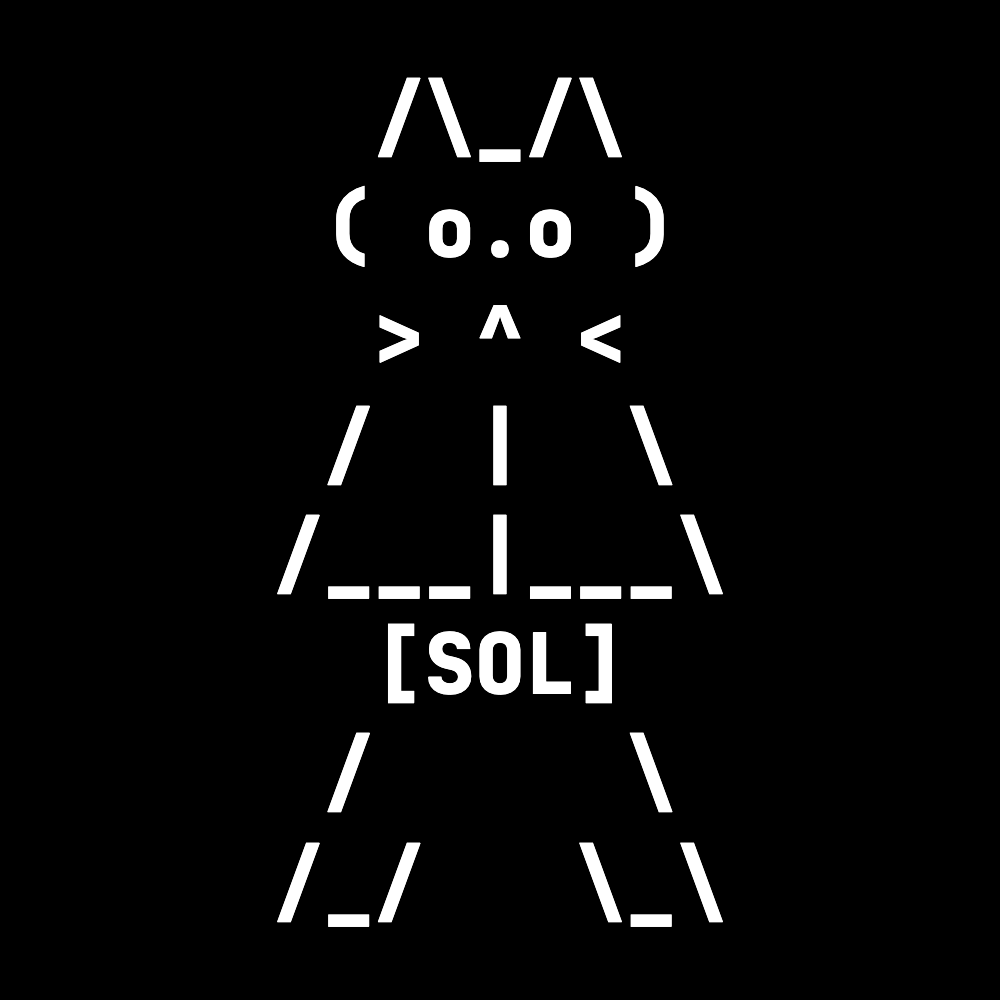

<p align="center"></p>

<h1 align="center">$SCRAP · the Solana Trash Panda</h1>

<p align="center"><i>One degen's trash is another degen's treasury.</i></p>

<p align="center">
  <a href="https://scrap-plum-nine.vercel.app">Website</a> ·
  <a href="#how-it-works">How it works</a> ·
  <a href="#run-the-engine">Run the engine</a> ·
  <a href="#safety-rules-baked-in">Safety rules</a>
</p>

---

## Origin

We asked an AI one question:

> If you could launch a meme coin on Solana, what would it be like? And throw in a picture too.

It answered with a full brief: **$SCRAP, the Solana Trash Panda**. A self-aware raccoon astronaut that digs
through the dumpster and burns what it finds, an ASCII sketch of the mascot, a tagline and a rule set
(1B supply, 0% tax, no presale, no VC, "just memes and transparent burns").

```
    /\_/\      <- laser eyes: ON
   ( o.o )         $SCRAP
    > ^ <
   /  |  \      holding a glowing
  /___|___\     Solana validator trash can
    [SOL]         (neon purple/green)
   /     \
  /_/   \_\
```

This repository is that brief, shipped: the website and the engine that makes the burns real.

## How it works

$SCRAP is a standard pump.fun coin paired with SOL. Every trade pays pump.fun creator fees. The engine
turns those fees into burns on a fixed 3-minute clock. Each cycle is called a **dive**:

1. **Claim.** All unclaimed creator fees (bonding curve and PumpSwap) go to the engine wallet.
2. **Buy.** One market buy of $SCRAP with everything claimed, on the venue the coin trades on
   (curve, PumpSwap, Jupiter as a fallback).
3. **Burn.** Exactly the tokens that buy brought in are burned on-chain.

No team cut, no ops share, no sell path. A pot too small to be worth a transaction rolls into the next dive.

## Spec vs. shipped

| From the AI brief | Status |
|---|---|
| 1,000,000,000 supply, 0% tax | At launch (plain SOL pair) |
| Mint and freeze authority revoked | At launch (pump.fun default) |
| No presale, no VC | At launch (fair launch on the curve) |
| Transparent burns | Shipped: this engine, every transaction in the dive log |
| 50 / 20 / 20 / 10 allocation | Dropped: a fair launch has no allocation to split |
| "Recycle a rug" roast contest | Community, not built |
| Weekly Dumpster Dive vote, Scrap Badge cNFT | Later, not built |

## Repository layout

```
index.html, *.png      the website (static, deployed as is)
art/                   the pages that render logo.png / og.png from the ASCII mascot
engine/                the burn engine: Node 20+, Express, Postgres
  src/config.js        every setting, read from the environment
  src/diver.js         the dive: claim, one buy, measured burn
  src/pumpfun.js       pump.fun / PumpSwap / Jupiter transactions
  src/tracker.js       price, supply and fee-pot tracking
  src/api.js           JSON API + serves engine/public
  scripts/launch.mjs   create the coin (dry run by default)
  scripts/verify.mjs   simulate the engine's transaction paths, no keys
Dockerfile             one image: engine + page
```

## Run the engine

Requires Node 20+ and a Postgres database.

```bash
cd engine
npm install
cp .env.example .env      # set TOKEN_MINT, DATABASE_URL, RPC_URL
npm start                 # http://localhost:4000
```

Without `WALLET_PRIVATE_KEY` the engine runs in **watch mode**: it tracks the coin and records dry dives,
and nothing moves on-chain. With the creator wallet key it runs in **bot mode** and executes real dives.

| Variable | Default | Meaning |
|---|---|---|
| `TOKEN_MINT` | empty | The coin. Empty serves the page in "not started" mode. |
| `WALLET_PRIVATE_KEY` | empty | Creator wallet key (bs58 or JSON array). Empty means watch mode. |
| `DIVE_INTERVAL_SEC` | `180` | Seconds between dives. |
| `MIN_CLAIM_USD` | `0.1` | Do not claim dust. |
| `MIN_BUY_USD` | `0.25` | A smaller pot rolls into the next dive. |
| `GAS_RESERVE_SOL` | `0.01` | SOL the engine never spends on buys. |
| `SLIPPAGE_PCT` | `5` | Slippage for the buy. |
| `SCHEDULER_ENABLED` | `true` | Kill switch. `false` keeps the API up and moves nothing. |
| `DRY_RUN` | `false` | Force dry dives even with a key. |
| `DATABASE_URL` | local Postgres | Dive history and engine state. |
| `RPC_URL` | public mainnet | Use a paid RPC in production. |

### API

| Route | Returns |
|---|---|
| `GET /api/token` | Coin, market, fee pot, next dive time, totals |
| `GET /api/dives` | Dive history with claim, buy and burn signatures |
| `GET /api/chart` | Price candles plus the dives to plot on them |
| `GET /api/trades` | Recent trades, engine buys flagged |
| `GET /api/health` | Mode, scheduler state, next dive time |

### Launch script

```bash
node scripts/launch.mjs --name "SCRAP" --symbol SCRAP --image public/logo.png   # dry run: simulates create_v2
node scripts/launch.mjs ... --live                                             # sends it
```

It is a dry run unless `--live` is passed. `--quote PUMP` creates a custom pair with a tax instead of a
plain SOL coin.

## Safety rules baked in

- **Measured burns only.** The engine reads its token balance before the buy and burns the difference.
  It never burns "everything in the wallet", so a dev bag or a transfer sitting in the creator wallet is
  not touched. A burn that fails is recorded as owed and settled by the next dive.
- **Watch mode by default.** No key, no transactions.
- **Kill switch.** `SCHEDULER_ENABLED=false` stops claims, buys and burns without taking the site down.
- **Gas floor.** The engine refuses to fire below `MIN_GAS_SOL` and always keeps `GAS_RESERVE_SOL`.
- **No sell path.** There is no code that sells $SCRAP.

## Website

The site is a single static `index.html`. It reads `/api/token` and `/api/dives` when an engine is
reachable on the same origin and falls back to the 3-minute wall clock when it is not. Set the contract
address and the X link in the `CONFIG` object at the top of the script block.

## Disclaimer

$SCRAP is a memecoin with no intrinsic value and no expectation of financial return. Nothing here is
financial advice. The software is provided as is, under the MIT license. Read the code before you run it
with a funded wallet.
